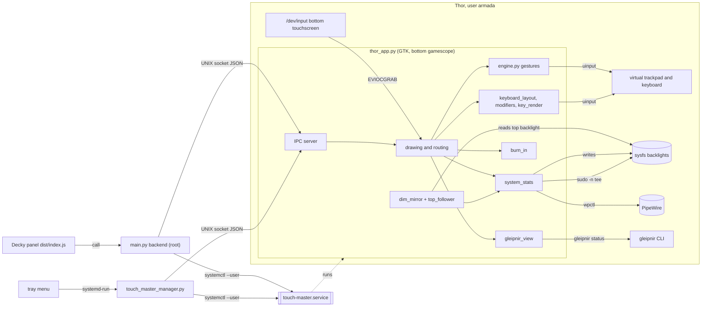

# 01 - Architecture and modules

## Processes

| Process | Started by | Runs as | Lifetime | Source |
|---|---|---|---|---|
| Driver `bin/thor_app.py` | `touch-master.service` (user unit), `ExecStart=/usr/bin/armada-run-bottom -- /usr/bin/python3 .../bin/thor_app.py` | user `armada` | long-running; `Restart=always`, `RestartSec=2` | `systemd/touch-master.service:8-14` |
| Decky backend `main.py` | Decky Loader, which calls `_main` on load | root (Decky) | as long as the plugin is loaded | `main.py:194-215`; `scripts/deploy.sh:15` (root-owned folder) |
| Decky panel `dist/index.js` | Decky Loader, when the Steam Quick Access panel is open | Steam UI | while the panel is shown | `dist/index.js:90`, `:606-627` |
| Standalone manager `bin/touch_master_manager.py` | the user, a desktop entry, or the driver's tray menu | user | while its window is open, or for one CLI command | `bin/touch_master_manager.py:421-461` |
| Tray stop helper | `systemd-run --user --collect --quiet <python> touch_master_manager.py --stop` | user, transient unit | one command | `bin/tray_actions.py:11-12`, `bin/thor_app.py:390-401` |
| Short-lived subprocesses | the driver and the backend | user, or root for `sudo` | per call | see the table below |

Short-lived subprocesses and their timeouts:

| Command | Called from | Timeout | Source |
|---|---|---|---|
| `wpctl get-volume @DEFAULT_AUDIO_SINK@` | `HardwareStats._sample` | 0.4 s | `bin/system_stats.py:315-321` |
| `wpctl set-volume`, `wpctl set-mute` | `set_volume`, `set_mute` | 0.5 s | `bin/system_stats.py:367-391` |
| `sudo -n tee <file>` | `_write_via_sudo` | 2.0 s (`SUDO_WRITE_TIMEOUT_S`) | `bin/system_stats.py:39`, `:48-54` |
| `gleipnir --status --json`, `systemctl is-active --quiet gleipnir`, `journalctl -t gleipnir` | `gleipnir_view` | 3.0 s, 2.0 s, 3.0 s | `bin/gleipnir_view.py:36`, `:43`, `:79-80` |
| `systemctl --user ...` and `systemctl --machine=armada@.host --user ...` | `main.py` `_run_systemctl` | 5.0 s, tried in that order | `main.py:214-238` |
| `systemctl --user ...` | manager | 2.0 to 3.0 s | `bin/touch_master_manager.py:78-117` |
| `systemd-run --user ... touch_master_manager.py --stop` | tray | none (`Popen`) | `bin/thor_app.py:396-399` |

## Modules

| Module | Role | Depends on | Source |
|---|---|---|---|
| `bin/thor_app.py` | the driver: window, drawing, touch routing, IPC server, tray, config load and save, startup and cleanup | every module below | `bin/thor_app.py` |
| `bin/engine.py` | `UInputBridge` (virtual devices) and `TouchGestureProcessor` (gestures) | `debug_codes` | `bin/engine.py:115-844` |
| `bin/touch_frames.py` | evdev bytes to frames with kernel timestamps; `SYN_DROPPED` and resync | none | `bin/touch_frames.py` |
| `bin/keyboard_layout.py` | key geometry and hit test | none | `bin/keyboard_layout.py` |
| `bin/key_render.py` | key label drawing | `theme`, cairo | `bin/key_render.py` |
| `bin/keyboard_settings.py` | keyboard timings, limits, clamp | none | `bin/keyboard_settings.py` |
| `bin/modifiers.py` | Shift, Ctrl, Alt, Win state machine; returns events, does not send them | none | `bin/modifiers.py` |
| `bin/burn_in.py` | orbit offset, hint alpha, idle luminance | none (takes times as arguments) | `bin/burn_in.py` |
| `bin/theme.py` | palette constants | none | `bin/theme.py` |
| `bin/system_stats.py` | sampler, cached stats, latest-value writers, sysfs and `wpctl` access | none in the repo; uses `subprocess` for `wpctl` and `sudo` | `bin/system_stats.py` |
| `bin/dim_mirror.py` | idle tracker (input devices) and the dim mirror thread | `top_follower`, `debug_codes` | `bin/dim_mirror.py` |
| `bin/top_follower.py` | pure dim and restore decision from the top backlight | none | `bin/top_follower.py` |
| `bin/pen_mode.py` | Pen mode values, cycling, migration | none | `bin/pen_mode.py` |
| `bin/session_cursor.py` | Pen + override file and the running gamescope delay | none | `bin/session_cursor.py` |
| `bin/gleipnir_view.py` | read-only Gleipnir status, sysfs and journal | none | `bin/gleipnir_view.py` |
| `bin/ipc_util.py` | IPC framing and request builders, shared by the manager and tests | none | `bin/ipc_util.py` |
| `bin/atomic_json.py` | atomic JSON write | none | `bin/atomic_json.py` |
| `bin/tray_actions.py` | the tray Stop command | none | `bin/tray_actions.py` |
| `bin/touch_master_manager.py` | standalone GTK window and CLI | `atomic_json`, `ipc_util` | `bin/touch_master_manager.py` |
| `debug_codes.py` | the code registry, logger, and self-test | none | `debug_codes.py` |
| `main.py` | Decky backend: driver install from the release zip, systemd control, IPC client, config | `debug_codes` | `main.py` |
| `dist/index.js` | Decky panel: a plain-JavaScript file with no build step | Decky globals `DFL`, `SP_REACT`, `SP_JSX` | `dist/index.js:1-16` |

`main.py` carries its own copies of the atomic write and the IPC read loop, because only `main.py` and `debug_codes.py`
are installed in the plugin folder (`main.py:149` and `:35-57`; `bin/atomic_json.py` header). Tests check the two
copies (`tests/test_atomic_json.py`).

Imports that need the Thor's GTK are kept out of the logic modules. `bin/engine.py` imports `fcntl` optionally
(`bin/engine.py:15-18`), so the gesture engine is testable on any OS.

## Module relationships

Arrows are the calls in the code. `SVC` stands for `touch-master.service`; the driver process is what it runs.

## Threads in the driver

| Thread | Created by | What it does | Period or wait | Source |
|---|---|---|---|---|
| GTK main | `Gtk.main()` in `main()` | drawing, GLib timers, idle callbacks, tray, signal handlers | event driven | `bin/thor_app.py:1603-1620` |
| Touch reader | `_start_touch_reader` | `select` on the grabbed node, then reads frames and calls `_dispatch_frame` under `input_lock` | `select` timeout 0.1 s; expires stale contacts when idle | `bin/thor_app.py:533-583` |
| IPC server | `_start_ipc_server` | accepts one connection at a time, reads one request, replies, closes | accept timeout 0.5 s; 2 s per request | `bin/thor_app.py:908-1026` |
| Stats sampler | `HardwareStats.start_sampler` | samples CPU, GPU, RAM, battery, volume, backlights | every 1.0 s | `bin/system_stats.py:204-219` |
| Write threads (4) | `_LatestWriter.submit`, the first time each one is used | write top backlight, bottom backlight, volume, mute | each write, then wait for the next value | `bin/system_stats.py:87-136`, `:160-165` |
| Idle tracker | `IdleTracker.start` | reads input events from every input device except the touchscreen; rescans the device list | `select` up to 1.0 s; rescan every 5.0 s | `bin/dim_mirror.py:140-216` |
| Dim mirror | `DimMirror.start` | runs the top follower and applies dims and restores; retries recovery | every 0.25 s | `bin/dim_mirror.py:247-250`, `:376-404` |
| Gleipnir view | `threading.Thread` in `start()` | reads Gleipnir status every 10 s while the view is on; the journal once a minute | `Event.wait(10.0)` | `bin/thor_app.py:284-298`, `:432` |
| Key repeat | `_start_key_repeat` per held key | taps the key after the delay and then at the interval | `Event.wait` | `bin/thor_app.py:403-423` |
| Glide | `_start_glide` per flick | emits relative motion while speed is above 12 px/s | 16 ms | `bin/engine.py:814-844` |
| Long-press timer | `threading.Timer` in `touch_down` | fires the right-click once | `long_press_delay_ms` | `bin/engine.py:615-619` |
| Button tap | `tap_button` per tap | sends press, sleeps 20 ms, sends release | 20 ms | `bin/engine.py:302-309` |

## Locks

| Lock | Protects | Taken by | Source |
|---|---|---|---|
| `ThorApp.input_lock` (re-entrant) | gesture state, keyboard and modifier state, mode and settings changes | touch reader around each batch; `set_mode`, `set_ui_hidden`, `set_pen_mode`, IPC `set_settings` | `bin/thor_app.py:176`, `:254`, `:303`, `:319`, `:548-575`, `:970` |
| `UInputBridge.lock` (re-entrant) | file descriptors and held-button and held-key sets, and the telemetry counters | every emit call; `release_all` holds it while it calls `mouse_button` and `key` | `bin/engine.py:120`, `:311-316` |
| `HardwareStats._lock` | cached data and optimistic values | `get_stats`, `_refresh`, `_show` | `bin/system_stats.py:155`, `:181-202` |
| `HardwareStats._sample_lock` | one sample at a time when the sampler is off | `_refresh` | `bin/system_stats.py:156`, `:197-202` |
| `_LatestWriter._cond` | the pending value and the busy flag | `submit`, `wait_idle`, the writer loop | `bin/system_stats.py:94`, `:101-136` |
| `DimMirror._stop` (event) | ends the dim loop and any fade | `stop`, the loop, the fade | `bin/dim_mirror.py:234`, `:252-259`, `:341` |

The modifier state (`ModifierState`) has no lock of its own. Its callers hold `input_lock`: the touch reader and the IPC
`set_mode` path both do (`bin/thor_app.py:548-575`, `:303-313`). **Unverified** that no other path calls it without the lock.

`IdleTracker` writes `_last` from its own thread and reads it from others (`poke`, `idle_seconds`). Each is a single float
assignment or read, so no lock is taken (`bin/dim_mirror.py:134-138`).

## Start-up and shutdown order

Start (`ThorApp.start`, `bin/thor_app.py:425-436`):
1. stats sampler starts (one synchronous sample first);
2. the cursor status is read and `wake_pointer` is set;
3. touch reader starts (or schedules a retry);
4. IPC server binds the socket;
5. idle tracker, dim mirror and Gleipnir thread start;
6. window shows;
7. the one-second GLib timer for the ribbon starts.

Shutdown (`ThorApp.cleanup`, `bin/thor_app.py:475-500`): dim restore (waits up to 2 s for the fade thread), idle tracker
stop, sampler stop, key repeat stop, then the stop flags of the touch reader, Gleipnir and IPC; socket file removed,
touchscreen released, virtual devices closed. Each step is wrapped so one failure does not stop the rest
([05](05-error-handling-os-constraints.md#shutdown)).

## Configuration model

The driver has one config dictionary per concern (`mirror_cfg`, `keyboard_cfg`, `gleipnir_cfg`, the gesture engine's
attributes, `mode`, `pen_mode`, `show_debug_hud`). `save_config` merges them into the file's current content
(`bin/thor_app.py:225-248`). The Decky backend and the manager keep no dictionary in memory: each call reads the file,
changes what it needs, and writes it back (`main.py:137-190`, `bin/touch_master_manager.py:56-71`).
