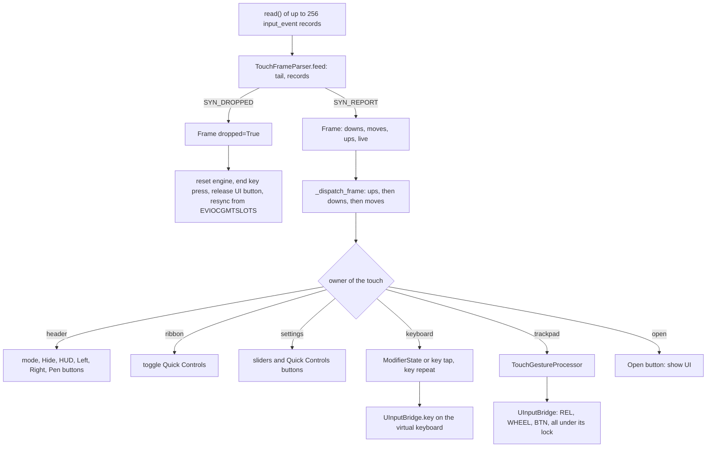
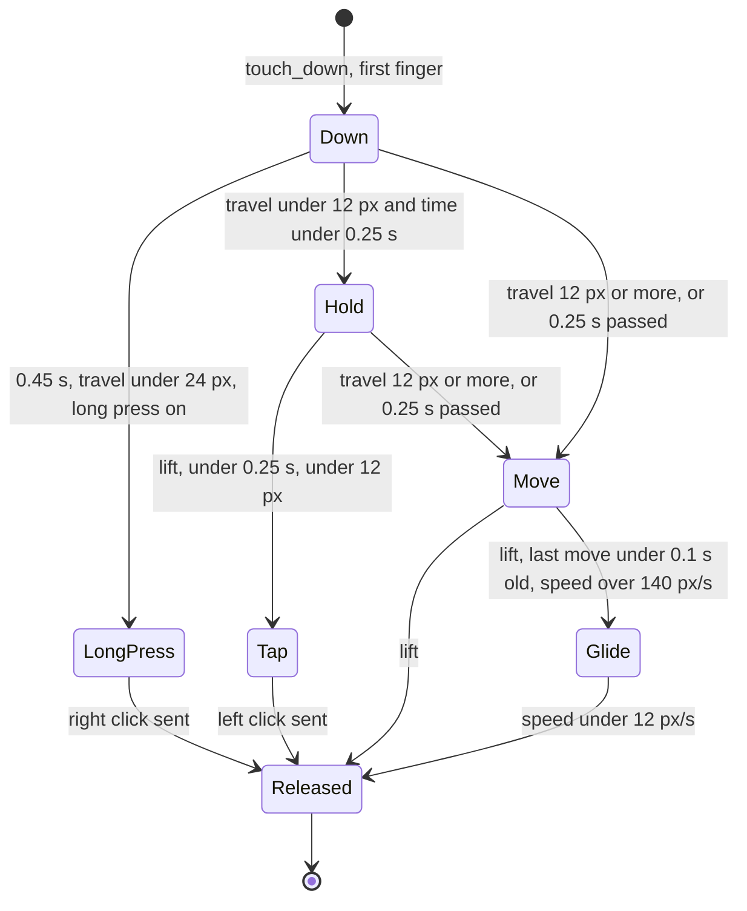

# 02 - Touch path

From the digitizer's bytes to a virtual pointer event or a key event on the top screen.

## Kernel record format

| Field | Size | Meaning | Source |
|---|---|---|---|
| `tv_sec` | `long` | kernel timestamp, seconds | `bin/touch_frames.py:13` (`EVENT_STRUCT = struct.Struct("llHHi")`) |
| `tv_usec` | `long` | microseconds | same |
| `type` | `unsigned short` | `EV_SYN` (0) or `EV_ABS` (3) | `bin/touch_frames.py:15-16` |
| `code` | `unsigned short` | `SYN_REPORT` (0), `SYN_DROPPED` (3) under `EV_SYN`; `ABS_MT_*` under `EV_ABS` | `bin/touch_frames.py:17-22` |
| `value` | `int` | the value | same |

The struct has native alignment, so a record is 24 bytes on a 64-bit build. **Assumption:** the Thor's Python and
kernel are 64-bit aarch64. The repo does not check this, and the 16-byte layout of a 32-bit `time_t` would break the parser
(**unverified** for the Thor; the code and docs describe only 64-bit assumptions).

Multitouch codes used: `ABS_MT_SLOT` (0x2F), `ABS_MT_POSITION_X` (0x35), `ABS_MT_POSITION_Y` (0x36),
`ABS_MT_TRACKING_ID` (0x39) (`bin/touch_frames.py:19-22`).

## Parser

`TouchFrameParser.feed` (`bin/touch_frames.py:47-70`):

1. Prepends the unfinished tail from the last read, and cuts the data to whole records. A record split between two reads
   is completed by the next read (`tests/test_touch_frames.py`, "a read that ends mid-event").
2. `SYN_DROPPED`: resets slot, tracking and position state and emits a frame with `dropped=True`.
3. `ABS_MT_SLOT` sets the current slot. `ABS_MT_TRACKING_ID` with a value of 0 or more assigns the id to the slot. A
   negative value (-1) removes the slot's id.
4. `ABS_MT_POSITION_X` and `_Y` store the raw position in the current slot.
5. `SYN_REPORT` closes the frame with the kernel timestamp (`_close_frame`, `:86-103`).

`_close_frame` computes, for every slot with an id, the screen position of its raw coordinates, then compares the set of
live ids with the set of ids active before:

| Result list | Condition |
|---|---|
| `ups` | active before, not live now |
| `downs` | live now, not active before; the position is recorded |
| `moves` | active before and live, with a position different from the last one |

A contact whose position did not change is in none of the lists. `live` is the number of live contacts.

Timestamps: the frame carries the kernel time, and the gesture engine uses it for all timing. The reader's own clock is
not used for gestures (`bin/touch_frames.py:3-5`). The engine's `expire_stale` takes the frame time too
(`bin/thor_app.py:593`).

## Coordinates

`raw_to_screen(raw_x, raw_y) -> (float(raw_y), float(1079 - raw_x))` (`bin/engine.py:110-112`). The digitizer's raw axes
are rotated 90 degrees with respect to the drawing space: raw Y becomes screen X, and inverted raw X becomes screen Y.
The panel's physical mounting is the reason for this, per the code comment and the Barry credit
(`CREDITS.md`, licence note on `raw_to_screen`).

## Resynchronisation after `SYN_DROPPED`

The kernel's buffer overflowed, so the parser has lost its state. The driver reads the kernel's slot table
(`bin/thor_app.py:622-635`):

- `EVIOCGABS(ABS_MT_SLOT)` returns a 24-byte `input_absinfo`; its third int is the maximum slot, so there are
  `maximum + 1` slots (`:624-626`).
- `EVIOCGMTSLOTS` is called once per code (tracking id, X, Y) with a buffer of one `u32` code followed by one `s32`
  value per slot (`:628-631`). The ioctl number is `_IOC(_IOC_READ, 'E', 0x0a, len)` (`:110-111`).
- Slots with a tracking id of 0 or more become contacts (`:632-635`).

`TouchFrameParser.resync` rebuilds the state from those slots and returns a frame whose `downs` are the live contacts;
`_resync_contacts` passes each one to `_handle_touch_down` (`bin/touch_frames.py:72-84`, `bin/thor_app.py:637-649`).

The layout of `EVIOCGABS` and `EVIOCGMTSLOTS` is checked against the kernel's `include/uapi/linux/input.h`, as the
CHANGELOG says. **Unverified** in this review (the header was not read).

## Ownership of a touch

`_owner_at` (`bin/thor_app.py:671-687`) decides an owner from where the finger lands, in this order:

| Condition | Owner |
|---|---|
| UI hidden and inside the Open button, plus 24 px | `open` |
| UI hidden, anywhere else | `trackpad` |
| y < 80 (header) | `header` |
| 80 <= y < 168 (ribbon) | `ribbon` |
| mode `settings` | `settings` |
| mode `keyboard`, or mode `split` and y >= 500 | `keyboard` |
| otherwise | `trackpad` |

The owner is stored per touch id in `_touch_owner` and kept until the touch lifts (`:173`, `:726`, `:781`). A drag that
crosses the split line stays a trackpad drag. A move or up for an id with no owner goes to the engine unless the mode is
`settings` (`:773`, `:796`). Those touches come from before a restart or from a dropped frame.

Frame handling order in `_dispatch_frame` (`:591-620`): `ups` first, then `downs`, then `moves`. If the frame has no
contacts and no downs, the engine is reset (`:611-612`). A log line records when the digitizer's count and the
engine's count differ (`:614-619`).

## Gesture engine

`TouchGestureProcessor` (`bin/engine.py:350`). The field `last_state_label` names the current state for the HUD and the
debug output. The states are not an enumeration in the code.

### One finger

Details (`bin/engine.py` line numbers in brackets):

- The cursor is held while the touch could still be a tap. Movement starts when the finger has travelled 12 px or been down
  for 0.25 s. The travel before that is not replayed [`:664-670`].
- Each move step is `dx * sensitivity * accel`, with `accel = 1 + min(1.6, hypot(dx, dy) / 25)`. The integer part is
  emitted and the fraction is kept for the next step, per axis [`:674-683`].
- Velocity for the glide is recorded on every move step, with the kernel time [`:688-690`]. A lift more than 0.1 s after the
  last record starts no glide [`:780-782`].
- A tap needs `accum_dist < 12 * max_fingers`, duration under 0.25 s, and no pointer movement [`:786`].
- The long press timer is a `threading.Timer`. It fires only if the finger is alone, has not started to move the
  pointer, and has travelled less than 24 px [`:568-573`, `:661-662`].

### Two and three fingers

- Two fingers scroll. Each move step produces `int(-dy * 120 / divisor)` and `int(dx * 120 / divisor)` hi-res units, where
  `divisor = max(4, 22 - 4 * scroll_speed)` [`:692-699`]. The `int()` truncates toward zero on each step, so a sub-unit
  movement is dropped instead of carried over. **This is a design observation from the code**, not a measured effect.
- Three fingers can swipe. The start centroid is taken when the third finger lands [`:624-627`]. A swipe fires once past
  85 px and can fire again only after a finger lifts below three [`:701-724`, `:768-769`].
- Two-finger tap right-clicks and three-finger tap middle-clicks, both when the maximum finger count was that many
  and the travel was within the tap limit [`:794-801`].

### Four or more fingers

`MISUSE_FINGERS = 4` [`:95`]. At the fourth finger the engine sets `misuse_lock`, cancels the long press, and ignores
moves. The lock clears when no contact is left [`:589-597`, `:756-766`].

### Stale contacts

A contact whose last report is more than 1.5 s old is dropped (`_drop_stale_contacts`, `:497-511`). The id goes into
`_expired_tids`. If that id reports a move later, the engine treats it as a new touch, because the kernel may have reused
the slot of a lost lift (`:629-638`).

### Pen mode

With `stylus_mode` on (`bin/engine.py:579-580`):

- A second contact while one is down returns from `touch_down` without being tracked.
- The first contact's landing position decides a strip: the right strip (x >= 1130) or the bottom strip (y >= 980)
  (`_strip_at`, `:513-518`). A strip touch scrolls, a non-strip touch moves the pointer.
- A strip scrolls only after 4 px of travel, reverses direction only after a step of 1.5 px or more, and boosts its gain
  with speed up to 3x (`:536-561`).
- A pen tap clicks only as the second of two taps within 0.45 s and 60 px. The first tap sets the reference
  (`_pen_tap`, `:520-534`).
- Glide is off in Pen mode [`:802`].

### Pointer nudge

Before a scroll or a button press, `UInputBridge._wake_pointer_locked` sends a one-pixel move out and then back, if
`wake_pointer` is set and the pointer has not moved for more than 2 s (`bin/engine.py:206-214`, `:240`, `:268`). The
timer is `moved_at`, set by every pointer move the bridge sends (`:201-203`).

## Keyboard path

The keyboard's handlers are in `bin/thor_app.py` (`_keyboard_down` `:742-762`, `_handle_touch_move` `:764-777`,
`_handle_touch_up` `:779-800`).

- A modifier key goes to `ModifierState.press`, which returns key events to send (`bin/modifiers.py:119-133`).
- A normal key first ends any key already held, calls `mods.key_typed()`, sends a tap, and starts the key repeat
  (`bin/thor_app.py:752-761`).
- `UInputBridge.tap_key` sends the press, **sleeps 20 ms**, then sends the release (`bin/engine.py:296-300`). The keyboard
  calls it from the touch reader while `input_lock` is held, so each key tap delays the reader by about 20 ms.
  **Design observation from the code**; not measured here.
- A touch that slides off its key ends the press (`:767-770`).
- A modifier held by one finger is released when that finger lifts (`ModifierState.release`, `bin/modifiers.py:135-146`).

## Header and Quick Controls

- Header touches act on press only (`_handle_header_touch`, `:801-817`). The Left and Right header buttons send a button
  press when touched and a release when the touch ends (`:812-815`, `:714-717`).
- Quick Controls sliders take their value from the x coordinate, clamped to the slider span, and keep following the
  finger that grabbed them (`_handle_settings_touch` `:819-863`, `_handle_settings_drag` `:889-902`).
- The Quick Controls buttons act on press (`:865-884`).
