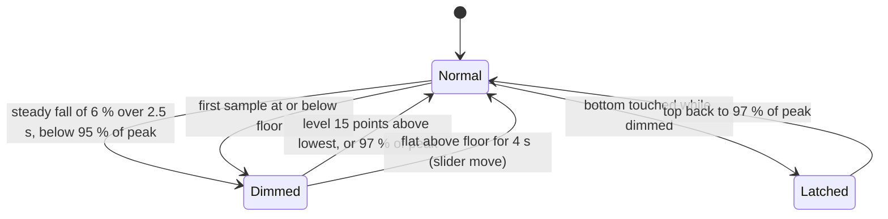

# 03 - Timing, idle, throttling and the dim

## Timing constants

| Quantity | Value | Where | What it controls |
|---|---|---|---|
| Touch reader `select` timeout | 0.1 s | `bin/thor_app.py:539` | how often idle expiry runs with no touches |
| Stale contact | 1.5 s | `bin/engine.py:89` | a silent contact is treated as lifted |
| Tap time | 0.25 s | `bin/engine.py:70` | longest tap and the point where a hold becomes a move |
| Tap travel | 12 px per finger | `bin/engine.py:71` | most travel a tap can have |
| Long-press time | `long_press_delay_ms`, default 0.45 s, clamp 0.2 to 1.2 s | `bin/engine.py:72`, `:362`, `:445-446` | the right-click hold |
| Long-press travel | 24 px | `bin/engine.py:73` | most travel a long press can have |
| Glide idle | 0.1 s | `bin/engine.py:92` | longest gap between the last move and the lift for a glide |
| Glide start speed | 140 px/s | `bin/engine.py:804` | minimum speed to glide |
| Glide stop speed | 12 px/s | `bin/engine.py:830` | speed below which the glide ends |
| Glide tick | 16 ms | `bin/engine.py:823-840` | glide step interval |
| Glide decay | `0.97 - (friction - 1) / 9 * 0.23` per tick | `bin/engine.py:821` | 0.97 at friction 1, 0.74 at 10 |
| Pointer wake | 2.0 s | `bin/engine.py:84` | stillness before a scroll or press gets a nudge |
| Pen double tap | 0.45 s, 60 px | `bin/engine.py:106-107` | the second tap of a pen click |
| Misuse fingers | 4 | `bin/engine.py:95` | fingers that lock out output |
| Stats sampler period | 1.0 s | `bin/system_stats.py:204` | how often the sample runs |
| Stats cache TTL | 0.4 s | `bin/thor_app.py:137` | used only when the sampler is not running |
| Slider optimistic hold | 1.5 s | `bin/system_stats.py:146` | how long a requested value overrides the sample |
| `wpctl` read timeout | 0.4 s | `bin/system_stats.py:319` | volume read |
| `sudo tee` timeout | 2.0 s | `bin/system_stats.py:39` | a write that times out is checked by reading back |
| Ribbon refresh | 1.0 s | `bin/thor_app.py:435`, `:443-448` | redraw and pointer-status refresh |
| Burn-in orbit cycle | 90 s, radius 1.5 px | `bin/thor_app.py:151` | the UI's translation |
| Idle veil | after 30 s, fades over 5 s to 40 % | `bin/thor_app.py:151`, `bin/burn_in.py:66-74` | luminance floor |
| Trackpad hint | shown 5 s, fades over 1.5 s | `bin/burn_in.py:54-64` | center hint |
| Gleipnir poll | 10 s; journal every 6th poll (60 s) | `bin/thor_app.py:291-297` | status view |
| Touch device retry | 5 s | `bin/thor_app.py:509-530` | missing or ungrabbable node |
| IPC accept timeout | 0.5 s | `bin/thor_app.py:918` | shutdown responsiveness |
| IPC request limit | 2 s | `bin/ipc_util.py:18` | a stalled client cannot hold the server |
| Idle tracker rescan | 5.0 s | `bin/dim_mirror.py:119` | picks up devices that appear after start |
| Idle tracker `select` | up to 1.0 s | `bin/dim_mirror.py:195` | |
| Dim loop period | 0.25 s | `bin/dim_mirror.py:379` | top backlight read rate, four times a second |
| Dim fade | 6 steps, 0.15 s apart | `bin/dim_mirror.py:339`, `:359` | short ramp, not a cut |
| Dim recovery retry | every 5 s | `bin/dim_mirror.py:382` | put back a dim left by a crash |
| Dim write-failure backoff | 60 s | `bin/dim_mirror.py:351` | after an unwritable backlight |
| Dim restore-failure log | at most every 30 s | `bin/dim_mirror.py:305`, `:321` | keeps the log quiet |
| Slider input guard | 5 s | `bin/dim_mirror.py:35`, `:42` | a falling top with recent input is a slider drag |
| Dim restore on input | input within 1 s | `bin/dim_mirror.py:402` | the bottom comes back when the user touches anything |
| Panel poll | 2 s | `dist/index.js:139` | `get_status` |
| Panel hold after an edit | 3 s | `dist/index.js:29` | the value the user set wins over the poll |
| Panel slider throttle | first at once, then at most every 120 ms | `dist/index.js:122` | backend call rate during a drag |
| Panel refresh after a setting | 700 ms | `dist/index.js:181` | picks up the other right-click setting |
| Enable wait | up to 3.0 s, 0.1 s steps | `main.py` `set_enabled` | waits for the socket to agree |
| Decky `systemctl` timeout | 5 s | `main.py` `_run_systemctl` | |
| Manager refresh | 1 s, on a worker thread | `bin/touch_master_manager.py:286`, `:296-314` | window status |

## Burn-in

`BurnInProtector` takes times as arguments, so the logic is testable (`bin/burn_in.py:38-74`).

- **Orbit.** `phase = (t mod 90) / 90 * 2 pi`; `dx = 1.5 cos(phase)`; `dy = 1.5 sin(1.5 phase)` (`:46-52`). The
  second frequency is 1.5 times the first, so the path is a closed Lissajous curve, not a circle. The CHANGELOG
  calls it "circular", which is a loose description (see [06](06-design-decisions-roadmap.md#open-work)).
- **Hint.** `elapsed = min(t - start, t - mode_change)`, so the most recent of start and mode change sets the clock.
  Full alpha for 5 s, then linear to zero over 1.5 s (`:54-64`).
- **Veil.** `idle = t - last_touch`. Up to 30 s the scale is 1.0. Then it falls linearly to 0.4 over 5 s and stays there
  (`:66-74`). `ThorApp._paint` draws black over the frame with alpha `1 - scale` (`bin/thor_app.py:1068-1072`), so black
  stays black. `record_touch` is called on every touch frame and on the `wake` action (`:570`, `:1003`).

## Idle tracking

`IdleTracker` (`bin/dim_mirror.py:110-216`) answers "how long since any user input?".

- It opens every `/dev/input/event*` node whose name is not `bottom_touchscreen` and does not contain one of
  `haptics`, `Jack`, `lid`, `Thor Virtual`, `pmic_` (`:62-63`, `:147-148`). It rescans every 5 s and opens new nodes, drops
  missing ones (`:150-174`).
- A record counts as activity if (`_is_activity`, `:79-94`):
  - a key event with value 1 (press; repeats do not count);
  - any relative event;
  - for a device whose name contains "touchscreen", an absolute event with code at or above `ABS_MT_SLOT` or `ABS_X`/`ABS_Y`;
  - for other absolute axes: sticks (`ABS_X`, `ABS_Y`, `ABS_RX`, `ABS_RY`) beyond 8000 in either direction, triggers
    (`ABS_Z`, `ABS_RZ`) above 100, and the hat axes when non-zero.
- A select error drops every descriptor, and the next scan reopens them (`:194-199`). A read error drops that descriptor
  (`:205-208`).
- The bottom touchscreen is not in the tracker. Ratatoskr grabs it, so the driver calls `poke()` for each frame instead
  (`bin/thor_app.py:570`).

The tracker's own start time is not used for anything but the slider guard. `DimMirror` passes the tracker's idle time
and its own running time to `input_says_slider` (`bin/dim_mirror.py:38-42`, `:393`). Its docstring explains why: a
tracker that has only just started has seen no input, so its idle value says nothing (`:39-41`).

## Dim follower

`TopFollower` (`bin/top_follower.py`) is pure: it takes `(time, level)` and returns `"dim"`, `"restore"` or `None`,
where level is the top backlight as a fraction of its maximum.

Parameters (`bin/top_follower.py:123-125`):

| Name | Value | Meaning |
|---|---|---|
| `fall_s` | 2.5 s | window over which a fall must be steady |
| `fall_drop` | 0.06 | the fall must be at least 6 % of the level at the start of the window |
| `peak_ratio` | 0.95 | the level must be below 95 % of the recent peak |
| `back_ratio` | 0.97 | a level at or above 97 % of the peak restores |
| `rise` | 0.15 | a rise of 15 points above the lowest level restores |
| `settle_s` | 4.0 s | a dimmed state that has stopped falling above the floor for this long restores |
| `floor_ratio` | 0.06 | the floor, used by the settle rule |
| `keep_s` | 120 s | history kept |
| `max_step` | 0.25 | one drop larger than this in the window is a blank, not a ramp |

Update rule, in order (`update`, `:150-184`):

1. Append the sample, drop history older than 120 s, compute the peak (`:151-154`).
2. If latched by a bottom touch and the level is back above 97 % of the peak, clear the latch (`:155-156`).
3. If dimmed: track the lowest level; restore on a rise of 0.15 above it or a return to 97 % of the peak; otherwise, after
   4 s, restore if the level is above the floor and the last four seconds of samples are flat (range under 0.01)
   (`:157-168`).
4. If latched and not dimmed: nothing (`:169-170`).
5. First sample already at or below the floor: dim at once, assuming the normal level is full (`:171-174`). This is the
   restart-during-dim case.
6. Otherwise, over the last 2.5 s with at least three samples covering at least 2 s: dim if the samples never rise by more
   than 0.005, no single step drops more than 0.25, and the drop from the first sample is at least 6 %, and the level is
   below 95 % of the peak (`:175-183`).

`suppress()` latches the follower after a bottom touch and clears the dimmed flag; the latch clears only when the top has
come back to 97 % of its peak (`:145-148`). `reject()` drops the current dim decision and most of the history, so a
slider drag needs a fresh fall (`:139-143`).

Design basis, from the code and the module docstring: Steam's idle ramp is gradual, at a few percent per sample. The
blank before a suspend drops most of the range in one second, so a single large drop is excluded
(`bin/top_follower.py:111-121`, `:178-180`). Timestamps use `CLOCK_BOOTTIME` so a suspend shows as a time gap, not a steep
fall (`bin/dim_mirror.py:45-48`).

Tests that use Steam's recorded ramp are in `tests/test_top_follower.py`, for example
`test_steams_real_ramp_dims_early_even_when_sampled_once_a_second` and the sleep-blank case further down the same file.

## Dim mirror

`DimMirror` (`bin/dim_mirror.py:219-404`) runs `TopFollower` on its own thread. Each pass (`_run`, `:376-404`, every 0.25 s):

1. If recovery is pending and 5 s have passed since the last try, try recovery again (`:380-382`).
2. If `mirror_dim` is off: restore, reset the follower, next pass (`:383-387`).
3. Read the top level; if unreadable, next pass (`:388-390`).
4. `action = follower.update(boot_clock, level)` (`:391-392`).
5. `dim` while the input guard applies: `reject()` (`:393-394`). `dim` with the retry backoff over: `_dim`; if the write
   failed, reset the follower so the next ramp is tried (`:395-400`). `restore`: `restore()` (`:400-401`).
6. Otherwise, if dimmed and the tracker saw input within 1 s, restore for input and suppress the follower (`:402-404`).

`_dim(why, floor)` (`:331-363`):

- The current level is read from Armada's saved file, or from the stats if that is missing. The target is the floor, but
  no higher than the current level.
- The record is written first (`_write_record`, `:262-270`), then six steps of linear fade. Each step writes the backlight;
  only the last step also writes Armada's saved level (`persist=last`).
- If any step fails, the state is rolled back to the saved level, the record is removed, and the next attempt is 60 s away.

`restore(why)` (`:314-329`) writes the saved level with persist. On failure it keeps the state and the record, logs at
most every 30 s, and is tried again on the next pass. On success it clears the record.

`stop()` sets the stop event, joins the thread for up to 2 s so a fade in progress cannot run after the restore, and then
restores (`:252-259`). That ordering is the fix described in the CHANGELOG ("stopping the driver during the dim mirror's
0.75 s fade could leave the bottom screen dim").

Crash recovery (`recover`, `:280-311`): on start the record is read. If the saved level already equals the record, the
record is removed. Otherwise the saved level is written back. A failed write is retried every 5 s (`:380-382`). A record
that is unreadable, out of range or corrupt is deleted.

## Throttles and merges in the panel

- **Slider writes.** `makeThrottle(setTimer, 120)` sends the first value at once, then at most one more per 120 ms with
  the latest value, and `flush()` sends what is waiting when the panel unmounts (`dist/index.js:51-87`, `:122`, `:141-143`).
- **Status merge.** `mergeStatus` keeps the value the user set for 3 s after the edit, for each key that was edited
  (`dist/index.js:29`, `:34-49`). The hardware keys inside `hardware_stats` get the same treatment.

## Driver-side throttles

- **Hardware writers.** Each control has a `_LatestWriter`. A submit while a write is busy replaces the pending value, so
  a drag causes one write per finished write, and the last value is always written (`bin/system_stats.py:87-136`).
- **Optimistic value.** `_show` puts the requested value into `_optimistic` for 1.5 s, and `get_stats` returns it over the
  real sample (`:225-227`, `:181-195`).
- **Key repeat.** A worker waits for the delay, then taps the key and waits for the interval, while the key is still held
  and is still the same key object. A new press stops the old worker first (`bin/thor_app.py:403-423`).
- **Glide.** One worker per flick. A new press sets the old worker's own stop event (`bin/engine.py:577`, `:814-844`).

## Timing of the stats and drawing path

- The sampler runs every second on its own thread. `get_stats` never samples on the caller's thread when the sampler is
  running (`bin/system_stats.py:181-187`, `:204-219`).
- Drawing reads cached values and does no I/O except the pointer-status refresh, which is in a GLib timer, not in `_paint`
  (`bin/thor_app.py:443-448`).
- The draw path measures its own time (`on_draw`, `bin/thor_app.py:1032-1040`). The panel reports the average, maximum and
  frame lag through `get_debug` (`:959-962`).
