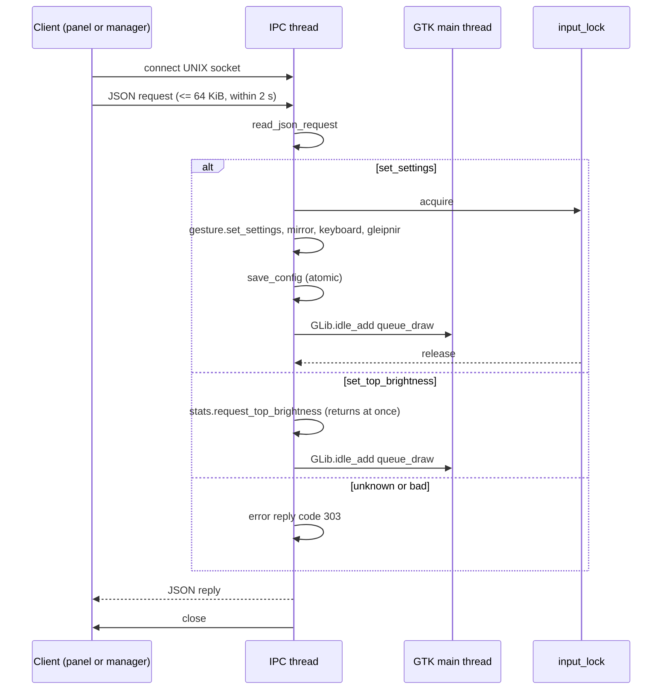
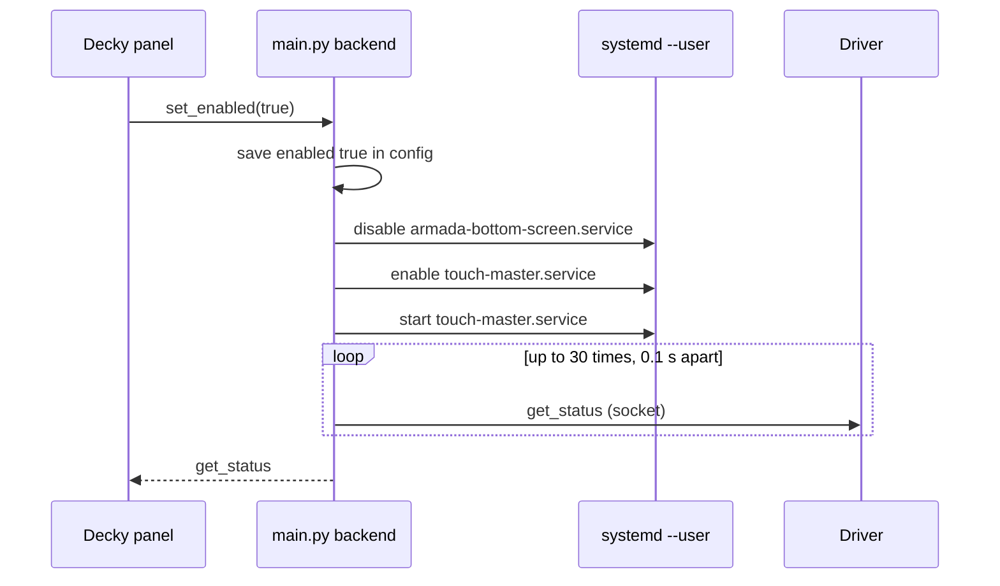
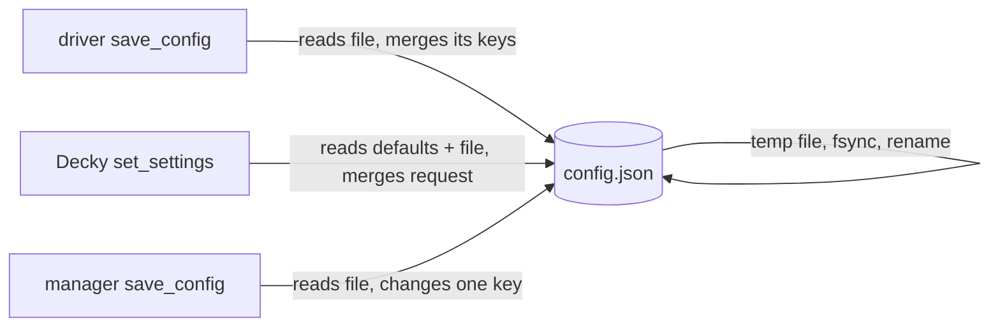
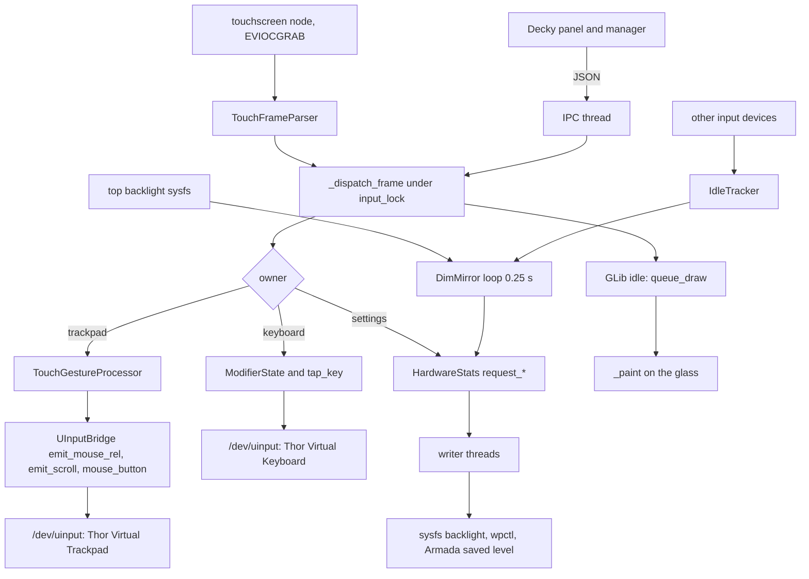

# 04 - IPC messages and data flow

## Message formats

The socket carries one JSON object per connection from the client, and one JSON object back. The driver writes the
reply and closes (`bin/thor_app.py:1015`). Clients read until end of file (`bin/ipc_util.py:46-64`, `main.py:35-57`).

### Request framing

- A request is at most 64 KiB (`bin/ipc_util.py:14`), may arrive in any number of pieces, and must complete within 2 s
  (`:18-43`). The parser tries `json.loads` after each piece, so the first complete JSON value ends the request.
- A connection that closes with no bytes gets no reply (`bin/ipc_util.py:37-38`, `bin/thor_app.py:931-932`).
- A connection that closes with partial bytes is parsed as is, and fails with `303` if it is not JSON
  (`bin/ipc_util.py:33-34`).

### Reply framing

- The driver sends the whole reply with one `sendall` (`bin/thor_app.py:1015`). The size of a status reply is described
  two ways: the CHANGELOG says it was under 1 KB on 2026-10-08, and the comment in `main.py` `_send_ipc` says several KB.
  The clients read to end of file, so either size is read whole.
- Clients accept up to 1 MiB (`bin/ipc_util.py:15`, `main.py:35-57`) and time out after 2 s.

### Examples

Request and reply pairs as the code produces them (key order follows the code's dictionary order):

| Request | Reply | Source |
|---|---|---|
| `{"action": "set_top_brightness", "brightness": 40}` | `{"ok": true, "code": 0, "top_bright_pct": 40}` | `bin/thor_app.py:987-990` |
| `{"action": "wake"}` | `{"ok": true, "code": 0}` | `bin/thor_app.py:998-1003` |
| `{"action": "nope"}` | `{"ok": false, "code": 303, "error": "unknown action: 'nope'"}` | `bin/thor_app.py:1013-1014` |
| `{"action": ` (cut off, then closed) | `{"ok": false, "code": 303, "error": "JSONDecodeError: ..."}` | `bin/thor_app.py:1016-1021`, `bin/ipc_util.py:37-43` |
| `[1, 2]` (a JSON array) | `{"ok": false, "code": 303, "error": "ValueError: a request must be a JSON object"}` | `bin/thor_app.py:933-934` |
| `{"action": "set_settings", "sensitivity": 2.0}` | `{"ok": true, "code": 0}` | `bin/thor_app.py:969-978` |

The `error` text for an exception is `"<ExceptionName>: <message>"` (`bin/thor_app.py:1017`).

### Shape of the status reply

`get_status` (`bin/thor_app.py:938-949`) returns the fields below. Values are examples of the types only.

| Field | Type | Source of the value |
|---|---|---|
| `ok`, `code` | bool, int | fixed |
| `mode` | string | `self.mode` |
| `debug_hud` | bool | `self.show_debug_hud` |
| `hardware_stats` | object | `HardwareStats.get_stats()`: `cpu_load`, `cpu_ghz`, `cpu_temp`, `gpu_mhz`, `gpu_temp`, `ram_used_gb`, `ram_total_gb`, `ram_pct`, `bat_cap`, `bat_status`, `bat_watts`, `vol_pct`, `vol_muted`, `top_bright_pct`, `bot_bright_pct` (`bin/system_stats.py:343-359`) |
| gesture settings | bool, int, float | `TouchGestureProcessor.get_settings()` (`bin/engine.py:460-473`) |
| `mirror_dim`, `mirror_dim_floor_percent` | bool, int | `mirror_cfg` |
| `keyboard_repeat_delay_ms`, `keyboard_repeat_interval_ms`, `keyboard_caps_window_ms` | int | `keyboard_cfg` |
| `gleipnir_ribbon`, `gleipnir_available` | bool | `gleipnir_cfg` and `gleipnir_view.find_script()` |
| `bottom_dimmed` | bool | `DimMirror.dimmed` |
| `cursor_stay_visible`, `cursor_hide_delay_ms`, `cursor_stay_visible_active` | bool, int or null, bool | `session_cursor.status` (`bin/thor_app.py:438-441`) |
| `pen_mode` | string | `self.pen_mode` |

`get_debug` (`bin/thor_app.py:950-966`) adds `telemetry` (`bin/engine.py:318-329`), `state`, `coords`, `touch_device`,
`active_fingers`, `digitizer_contacts`, `engine_contacts` (a map from contact id to `[x, y, age]`), `last_key`, `draws`,
`draw_ms_avg`, `draw_ms_max`, `frame_lag_ms_max`, and the hardware block and gesture settings.

### Decky backend output

`main.py` `get_status` builds its own dictionary from the driver's reply and the config file, and fills `enabled` (true
when the socket answers), `code` (0 running, 4 stopped), and the settings with their defaults
(`main.py:245-303` area; `_default_config` at `main.py:113-134`). When the driver is not running it returns the file's
settings, empty telemetry, `state: "STOPPED"`, and an empty hardware block (`main.py` `get_status`).

## Driver IPC server loop



## Panel data flow

```mermaid
sequenceDiagram
  participant U as User
  participant P as Decky panel
  participant T as Throttle (120 ms)
  participant B as main.py backend
  participant D as Driver
  U->>P: drags Top Screen Brightness to 40
  P->>P: markEdited top_bright_pct; setStatus locally
  P->>T: throttled send(40)
  T->>B: call set_brightness("top", 40)
  B->>D: {"action": "set_top_brightness", "brightness": 40}
  D-->>B: {"ok": true, "code": 0, "top_bright_pct": 40}
  B-->>P: reply
  loop every 2 s
    P->>B: get_status
    B->>D: get_status and get_debug
    D-->>B: replies
    B-->>P: merged status
    P->>P: mergeStatus keeps edited keys for 3 s
  end
```

Toggling "Enable Bottom Screen" is different: the panel waits for the backend, and the backend polls the socket:



Source: `main.py` `set_enabled` (line 302), `_start_service` (line 240), `_is_running` (line 108). The polling loop is in
`set_enabled` after the `_set` helper runs. Each `systemctl` attempt tries the `--machine=armada@.host` form first, then
the plain form (`main.py:214-238`).

## Configuration write path

Three writers exist. Each follows its own rule (see [01](01-architecture-modules.md#configuration-model)).



The driver's `save_config` starts from the file on disk, so keys the driver does not own, such as `enabled`, survive
(`bin/thor_app.py:228-245`). The Decky backend's `_read_config` starts from `_default_config` and updates from the file,
so a save writes every default key into the file (`main.py:113-146`). The manager starts from its `DEFAULT_CONFIG` the
same way (`bin/touch_master_manager.py:56-64`). Writes are atomic in all three (`bin/atomic_json.py`, `main.py:149-180`).

## Settings change in the driver

A setting changed in the panel has three effects in the driver, in this order: the engine's attributes change under
`input_lock`, the mirror and keyboard and Gleipnir values change, and then the file is saved and the screen redrawn
(`bin/thor_app.py:969-978`). The panel's values are not read back from the file. The driver writes its full set of keys
on each save (`:236-245`).

Two settings exclude each other in the engine: turning on `long_press_right_click` turns off `two_finger_right_click`,
and the reverse (`bin/engine.py:436-444`). The panel refreshes 700 ms after a setting so that the other one is shown
(`dist/index.js:181`).

## Data flow end to end



The engine and the keyboard write to the kernel only through `UInputBridge`. The dim mirror writes to the bottom backlight
only through `HardwareStats`, so there is one path for each kind of write.
